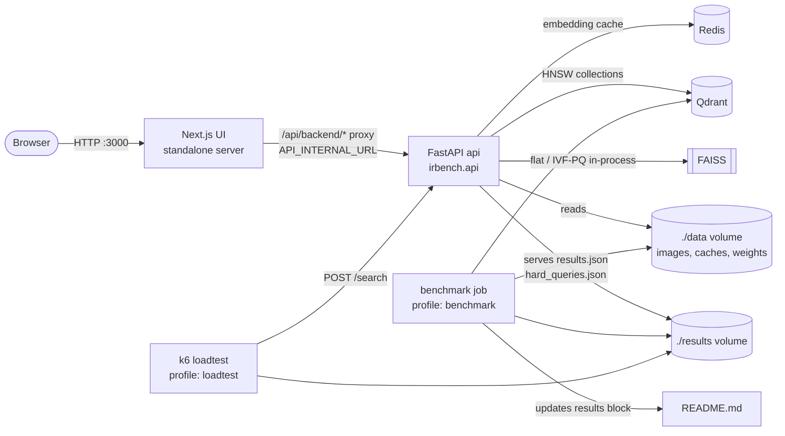
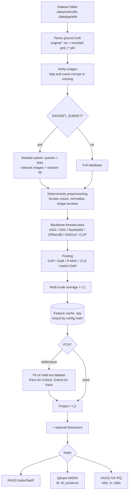
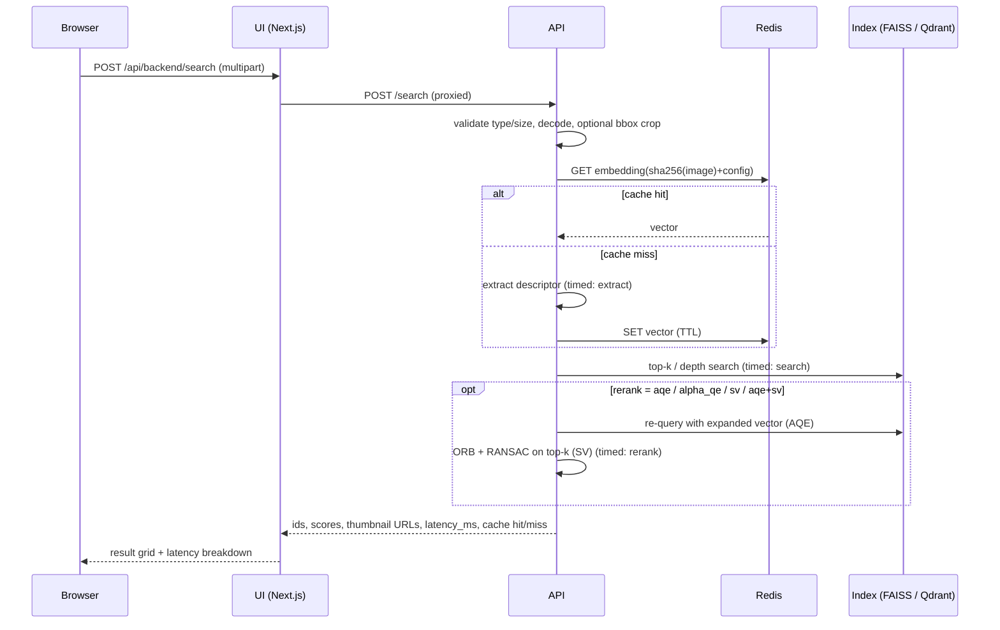

# Image Retrieval Benchmark Engine: Classical vs. CNN vs. Transformer Features at Scale

A benchmarked, containerised image-retrieval system. It measures the **accuracy / latency / memory trade-offs** of
global image descriptors (HOG, HSV histograms, ResNet50, EfficientNet-B0, DINOv2 ViT-S/14, CLIP ViT-B/32), pooling
operators (GAP, GeM, R-MAC, CLS, patch-GeM), post-processing (L2, held-out PCA-whitening), vector indexes (exact
FAISS, HNSW in Qdrant, FAISS IVF-PQ) and re-rankers (AQE, α-QE, ORB+RANSAC spatial verification) on the Oxford5k and
Paris6k landmark datasets under both the **original** and the **revisited** (ROxford/RParis Easy/Medium/Hard)
protocols. A FastAPI service and a deliberately thin Next.js UI make the benchmark matrix legible and let you query it.

> **Every number in this repository is produced by the benchmark harness.** The results block below is generated from
> `results/summary.md`; until you run the benchmark it says *No results generated yet*. Nothing here quotes
> performance figures from papers or from memory.

---

## Table of contents

1. [Overview, motivation, what is novel](#1-overview-motivation-what-is-novel)
2. [Quick start](#2-quick-start)
3. [Fast vs full mode, hardware, runtimes](#3-fast-vs-full-mode-hardware-requirements-expected-runtimes)
4. [Architecture](#4-architecture)
5. [Directory structure](#5-directory-structure)
6. [Datasets](#6-datasets)
7. [Theory primer](#7-theory-primer)
8. [Metrics explained](#8-metrics-explained)
9. [Configuration reference](#9-configuration-reference)
10. [API reference](#10-api-reference)
11. [Frontend guide](#11-frontend-guide)
12. [Running experiments and extending the system](#12-running-experiments-and-extending-the-system)
13. [Results](#13-results)
14. [Load testing](#14-load-testing)
15. [Design decisions and trade-offs](#15-design-decisions-and-trade-offs)
16. [Known limitations, failure cases, threats to validity](#16-known-limitations-failure-cases-threats-to-validity)
17. [Troubleshooting / FAQ](#17-troubleshooting--faq)
18. [Glossary](#18-glossary)
19. [Reporting guidance](#19-reporting-guidance)
20. [References](#20-references)
21. [License and contributing](#21-license-and-contributing)

---

## 1. Overview, motivation, what is novel

**What it is.** One harness turns a configuration — *(extractor, pooling, post-processing, index, re-ranker,
protocol, dataset)* — into a row of metrics: mAP (original and revisited E/M/H), Recall@1/5/10, p50/p95/p99 latency
split into *extract / search / rerank*, throughput, memory per vector, index size, build time and extraction time
per image. A YAML grid expands into hundreds of such rows; ten ablations (a–j) turn the rows into tables and plots.

**Why.** Retrieval papers usually report one number (mAP) for one pipeline. Engineering decisions need the joint
distribution: *how much mAP does a 10× smaller index cost? where does HNSW recall collapse as `ef` shrinks? is spatial
verification worth its latency? do self-supervised ViTs beat GeM-pooled CNNs on landmarks, and where do they fail?*
This project answers those questions with measurements taken on your hardware, with fixed seeds and logged library
versions.

**What is novel here** (as an engineering artefact, not a new algorithm):

- **One harness, all axes.** Classical, CNN and transformer descriptors flow through the same pooling,
  post-processing, index and re-ranking stages, so differences are attributable to the component being varied.
- **Both evaluation protocols** — the original Oxford/Paris protocol and the revisited Easy/Medium/Hard protocol —
  from the same ranked lists, with the official AP integration and junk handling.
- **Leak-free whitening.** PCA-whitening is always fit on the *other* dataset (Paris for Oxford and vice versa).
- **Honest memory accounting.** Exact byte breakdowns for FAISS indexes (codes, ids, centroids, codebooks), cross
  checked against FAISS serialisation; Qdrant HNSW memory is labelled as an *estimate*.
- **ANN quality separated from retrieval quality.** HNSW/IVF-PQ sweeps report neighbour recall versus exact search
  (does the index find the true nearest neighbours?) alongside mAP (does the system find the right landmark?).
- **Failure analysis per family** and a `hard_queries.json` of queries the best configuration still fails, with the
  ranked lists, rendered in the UI.
- **Reproducible serving path.** The API and UI run the same code as the benchmark, cache embeddings in Redis and
  refuse to serve before models and indexes are built.

---

## 2. Quick start

Prerequisites: Docker Engine with Compose v2 (Docker Desktop on macOS/Windows). Nothing else.

```bash
git clone <this repository> irbench && cd irbench
# Convenience target; equivalent to the docker compose command below.
make up
# Or run Compose directly:
docker compose up --build
```

That single command builds the images, starts Redis, Qdrant, the API and the UI, and (on first start) downloads
Oxford5k + ROxford ground truth into `./data`, extracts DINOv2 and HSV-histogram descriptors for the database and
builds the prebuild indexes from `configs/api.yaml`. Optional: `make env` first creates `.env` with your user id
(recommended on Linux, see [§17](#17-troubleshooting--faq)).

**Expected output.** Compose prints build logs, then JSON log lines from the API, e.g. messages with
`"msg": "warmup"` and stages `dataset` → `extracting` (with `done/total`) → `indexing` → `ready`. The UI container
starts as soon as the API is healthy; it shows **“Backend warming up”** with a progress bar until `/ready` reports
ready.

**URLs and ports**

| Service | URL | Notes |
|---|---|---|
| UI | http://localhost:3000 | `/search`, `/compare`, `/benchmark`, `/hard-queries` |
| API | http://localhost:8000 | OpenAPI docs at http://localhost:8000/docs |
| API readiness | http://localhost:8000/ready | 503 + progress while warming up, 200 when ready |
| Qdrant | http://localhost:6333 | dashboard at `/dashboard` |
| Redis | not published | internal only (`redis:6379`) |

Ports are configurable with `UI_PORT`, `API_PORT`, `QDRANT_PORT`.

**How to verify**

```bash
docker compose ps                                  # all services "healthy"
curl -s localhost:8000/health                      # {"status":"ok","version":"1.0.0"}
python3 scripts/wait_for_ready.py                  # blocks until /ready says ready (stdlib only)
curl -s -F image=@some_photo.jpg localhost:8000/search | python3 -m json.tool
```

Then run the benchmark (it is a separate, opt-in profile):

```bash
make bench-fast     # smoke benchmark: configs/fast.yaml with DATASET_SUBSET=300
make bench          # full benchmark: configs/full.yaml on the full datasets
```

Results land in `./results/` and this README's results block is regenerated automatically.

If the dataset hosts are unreachable, the API's `/ready` (and the UI) show the exact page to open and the folder to
put files in; see [§6](#6-datasets).

---

## 3. Fast vs full mode, hardware requirements, expected runtimes

| | fast (`make bench-fast`) | full (`make bench`) | ci (`make bench-ci`) |
|---|---|---|---|
| config | `configs/fast.yaml` | `configs/full.yaml` | `configs/ci.yaml` |
| data | ROxford5k + RParis6k, `DATASET_SUBSET=300` database images per dataset (seeded) | full ROxford5k + RParis6k, plus up to 10k revisitop1m distractors | generated toy datasets (no downloads) |
| input size | CNN 320 px, DINOv2 224 px | CNN 512 px, DINOv2 448 px, CLIP 224 px | 64–128 px, random-initialised CNN/ViT |
| planned runs (`irbench` plan) | 89 | 290 | 56 |
| distinct (dataset, descriptor) extractions | 24 | 62 | 18 |
| distractors | up to 1000 if present locally, not downloaded | first revisitop1m archive downloaded | 60 generated |
| purpose | minutes-scale end-to-end check of every ablation | the numbers to report | plumbing check (numbers meaningless) |

**Runtime.** Wall time is dominated by descriptor extraction (one forward pass per database image per descriptor
configuration; queries are timed one by one) and by HNSW construction in Qdrant. The harness records the actual wall
time of every benchmark in `results/results.json → meta.wall_time_s` and in `results/summary.md`; that is the
number to quote. The author could not execute the real-data benchmarks in the environment this project was written
in (see [the verification notes](#verification-status)); the only measured wall time available is the toy `ci`
config, which the harness reported as 54 s (full toy data) and 34 s (`DATASET_SUBSET=60`) on a 2-core Intel Xeon
@ 2.10 GHz without GPU. Expect real-data runs to be orders of magnitude longer on CPU; descriptors are cached on disk,
so re-runs and resumed runs skip extraction.

**Hardware.**

- CPU-only works. CUDA is auto-detected (`DEVICE=auto`) when the GPU override is used
  (`docker compose -f docker-compose.yml -f docker-compose.gpu.yml up --build`, NVIDIA Container Toolkit required).
  FAISS runs on CPU in both cases.
- Memory: the backend holds one backbone, one database descriptor matrix and one index at a time; Qdrant holds the
  HNSW collections. Give Docker several GB of RAM; Docker Desktop's default limit can be too small for the full run
  (symptom: containers killed with exit code 137, see [§17](#17-troubleshooting--faq)).
- Disk: datasets (several GB of JPEGs), model weights (cached in `./data/cache/{torch,huggingface}`), descriptor
  caches (`./data/cache/features`, one `.npy` per configuration) and Qdrant storage (named volume).

Resuming: every completed run is appended to `results/runs.jsonl`; re-running the same config skips finished runs.
Use `irbench bench --no-resume` to start over.

---

## 4. Architecture

### 4.1 System overview



### 4.2 Indexing data flow



### 4.3 Query data flow



### 4.4 Docker service topology

```mermaid
flowchart TB
  subgraph default[docker compose up --build]
    redis[redis:7.4.1-alpine<br/>healthcheck: redis-cli ping]
    qdrant[qdrant/qdrant:v1.12.4<br/>healthcheck: TCP 6333<br/>volume qdrant_storage]
    api[irbench-backend<br/>uvicorn :8000<br/>healthcheck: /health]
    ui[irbench-ui<br/>node server.js :3000<br/>healthcheck: /api/health]
  end
  subgraph profiles[opt-in profiles]
    bench[benchmark<br/>irbench bench]
    k6[loadtest<br/>grafana/k6:0.55.0]
  end
  redis -- service_healthy --> api
  qdrant -- service_healthy --> api
  api -- service_healthy --> ui
  qdrant -- service_healthy --> bench
  api -- service_healthy --> k6
```

`depends_on` uses `condition: service_healthy` everywhere. The API's *health* (process alive) is separate from its
*readiness* (models + indexes built): the UI starts as soon as the API is healthy so it can display the warm-up
state, and `/search` returns `503 not_ready` until readiness.

---

## 5. Directory structure

```
.
├── .dockerignore                      fallback ignore list for builders without per-Dockerfile ignore files
├── .env.example                       every environment variable with its default (copy to .env)
├── .gitignore                         ignores data, results, caches, node_modules, build output
├── .github/workflows/ci.yml           CI: backend lint+tests, frontend lint/typecheck/tests/build, images, smoke benchmark, API/UI/k6 smoke
├── CONTRIBUTING.md                    how to contribute, coding standards, how to add components
├── LICENSE                            MIT license
├── Makefile                           targets: help env up up-gpu down logs ps bench bench-fast bench-ci bench-ablation bench-gpu report loadtest test test-backend test-frontend lint clean
├── README.md                          this document (results block auto-generated)
├── docker-compose.yml                 services api, ui, redis, qdrant; profiles benchmark and loadtest
├── docker-compose.gpu.yml             NVIDIA override: CUDA torch wheels + GPU reservation for api/benchmark
├── ruff.toml                          Ruff lint + format configuration for all Python
├── backend/
│   ├── pyproject.toml                 irbench package metadata, console script `irbench`, pytest config
│   ├── requirements.txt               direct runtime dependencies (pinned)
│   ├── requirements-dev.txt           direct test/lint dependencies (pinned)
│   ├── requirements.lock              fully pinned transitive runtime set used by the Docker image
│   ├── requirements-dev.lock          fully pinned transitive runtime + dev set used by the image and CI
│   └── src/irbench/
│       ├── __init__.py                package version
│       ├── settings.py                the single typed Settings object (env vars) + ServingConfig (api.yaml)
│       ├── utils.py                   seeding, stable hashing, device detection, timers, latency stats, hardware info
│       ├── logging_utils.py           structured JSON logging
│       ├── postprocess.py             L2 normalisation and PCA / PCA-whitening (fit, transform, save/load)
│       ├── readme.py                  renders results/summary.md into the README's marked block
│       ├── cli.py                     `irbench bench|report|download|toy|update-readme|serve`
│       ├── features/
│       │   ├── __init__.py            public registry API
│       │   ├── base.py                FeatureExtractor interface (extract(images) -> np.ndarray) and registry
│       │   ├── preprocessing.py       deterministic loading, EXIF, bbox crop, resizing, thumbnails, decode checks
│       │   ├── pooling.py             GAP, GeM, R-MAC (+ region grid), CLS, patch-GeM, patch-mean
│       │   ├── classical.py           HOG and HSV colour-histogram extractors
│       │   ├── torch_base.py          shared torch preprocessing and shape-bucketed batching
│       │   ├── cnn.py                 ResNet50 and EfficientNet-B0 conv feature maps
│       │   ├── transformer.py         DINOv2 ViT-S/14 and CLIP ViT-B/32 (Hugging Face)
│       │   └── cache.py               on-disk descriptor cache keyed by config hash; per-query timing
│       ├── indexes/
│       │   ├── __init__.py            index registry and factory
│       │   ├── base.py                VectorIndex interface (build, search, memory_bytes, build_time) + MemoryReport
│       │   ├── flat.py                exact FAISS IndexFlatIP
│       │   ├── ivfpq.py               FAISS IVF-PQ with parameter clamping and exact memory accounting
│       │   └── hnsw_qdrant.py         HNSW via Qdrant (server or embedded), indexing wait, memory estimate
│       ├── rerank/
│       │   ├── __init__.py            re-ranker registry, `aqe+sv` chains
│       │   ├── base.py                Reranker interface, RerankContext, Ranking
│       │   ├── qe.py                  average query expansion and alpha-QE
│       │   └── spatial.py             ORB + RANSAC spatial verification with keypoint cache
│       ├── data/
│       │   ├── __init__.py            dataset registry (load_dataset), held-out pairing
│       │   ├── base.py                Query / Protocol / RetrievalDataset, missing-image removal, seeded subsets
│       │   ├── download.py            URL list, download + extraction, manual-placement instructions
│       │   ├── oxford_paris.py        original *.txt and revisited gnd_r*.pkl parsers, image verification
│       │   ├── distractors.py         seeded distractor subsampling from any image folder
│       │   └── toy.py                 procedurally generated toy datasets in the official formats
│       ├── eval/
│       │   ├── __init__.py            exports
│       │   └── metrics.py             official AP, mAP per protocol/setup, Recall@K, ANN neighbour recall
│       ├── bench/
│       │   ├── __init__.py            exports
│       │   ├── config.py              BenchmarkConfig / RunConfig models, grid expansion
│       │   ├── runner.py              the harness: config -> metrics, caching, timing, resume
│       │   ├── store.py               runs.jsonl and per-run ranked lists
│       │   ├── ablations.py           ablation tables (a-j) computed from run records
│       │   ├── plots.py               one PNG per ablation (matplotlib, Agg)
│       │   └── report.py              results.json, results.csv, summary.md, hard_queries.json
│       └── api/
│           ├── __init__.py            entry-point docstring
│           ├── main.py                FastAPI app factory, routes, middleware, CORS, size limits
│           ├── engine.py              serving engine: warm-up, lazy feature spaces/indexes, search, images
│           ├── schemas.py             Pydantic v2 request/response models
│           ├── errors.py              consistent error schema and exception handlers
│           ├── cache.py               Redis embedding cache with graceful degradation
│           └── metrics.py             Prometheus metrics
├── configs/
│   ├── fast.yaml                      fast benchmark grid (all ablations, reduced resolution)
│   ├── full.yaml                      full benchmark grid
│   ├── ci.yaml                        offline toy-data grid used by CI and `make bench-ci`
│   ├── api.yaml                       serving configuration (dataset, backbones, prebuild, index defaults)
│   └── api.ci.yaml                    offline serving configuration on toy data (CI)
├── data/.gitkeep                      mounted at /data: datasets, distractors, caches, model weights
├── docker/
│   ├── backend.Dockerfile             multi-stage Python 3.11 image (CPU or CUDA torch), non-root user
│   ├── backend.Dockerfile.dockerignore whitelist of files sent to the backend build
│   ├── frontend.Dockerfile            multi-stage Node 20 image: deps, test, builder, standalone runner
│   └── frontend.Dockerfile.dockerignore whitelist of files sent to the frontend build
├── docs/
│   └── results-schema.md              field-by-field description of results.json, runs.jsonl, hard_queries.json, k6 summary
├── frontend/
│   ├── package.json / package-lock.json  pinned dependencies and scripts (dev, build, lint, typecheck, test, format)
│   ├── next.config.mjs                standalone output
│   ├── tsconfig.json                  strict TypeScript
│   ├── tailwind.config.ts             Tailwind (class-based dark mode)
│   ├── postcss.config.mjs             Tailwind + autoprefixer
│   ├── .eslintrc.json                 next/core-web-vitals + next/typescript + prettier
│   ├── .prettierrc.json / .prettierignore  Prettier (with Tailwind class sorting)
│   ├── vitest.config.ts / vitest.setup.ts  unit-test runner (jsdom + Testing Library)
│   ├── next-env.d.ts                  Next.js type references
│   ├── public/favicon.svg             icon
│   └── src/
│       ├── app/layout.tsx             shell: nav, skip link, theme bootstrap
│       ├── app/globals.css            Tailwind layers and small component classes
│       ├── app/page.tsx               redirects to /search
│       ├── app/search/page.tsx        upload + config + result grid + latency + cache badge
│       ├── app/compare/page.tsx       same query through two configs, unique results highlighted
│       ├── app/benchmark/page.tsx     sortable results matrix + four charts + ablation notes
│       ├── app/hard-queries/page.tsx  failure cases: query, expected positives, returned list
│       ├── app/api/backend/[...path]/route.ts  same-origin proxy to the API (API_INTERNAL_URL at runtime)
│       ├── app/api/health/route.ts    UI liveness for the Docker healthcheck
│       ├── components/*.tsx           Nav, ThemeToggle, ReadinessGate, StateViews, Dropzone, ConfigForm,
│       │                              ResultGrid, LatencyBreakdown, SortableTable, BenchmarkCharts
│       ├── components/components.test.tsx  component tests
│       ├── lib/api.ts                 zod schemas + typed API client
│       ├── lib/api.test.ts            API-client tests
│       ├── lib/format.ts              formatters, Pareto frontier, log ticks, sorting
│       ├── lib/format.test.ts         helper tests
│       └── lib/hooks.ts               useReady (polls /ready), useAsync
├── loadtest/search.js                 k6 scenario: ramp, warm/cold mix, thresholds, JSON summary
├── results/.gitkeep                   mounted at /results: benchmark and load-test outputs
├── scripts/
│   ├── download_datasets.py           `irbench download` wrapper
│   ├── run_benchmark.py               `irbench bench` wrapper
│   ├── generate_toy_data.py           `irbench toy` wrapper
│   ├── update_readme_results.py       fills the README results block (stdlib + backend/src only)
│   └── wait_for_ready.py              polls /ready (stdlib only)
└── tests/
    ├── __init__.py                    makes tests a package (relative conftest imports)
    ├── conftest.py                    toy-data fixture, isolated settings
    ├── test_metrics.py                AP with known answers, junk handling, Recall@K, ANN recall
    ├── test_revisited.py              Easy/Medium/Hard protocol on a toy case
    ├── test_pooling.py                GeM(p=1)=GAP, GeM→max, R-MAC, token pooling, extractor contracts
    ├── test_indexes.py                shapes, exact neighbours, PQ/flat/HNSW memory accounting
    ├── test_postprocess.py            whitening decorrelates, rank clamp, save/load
    ├── test_rerank.py                 AQE, alpha-QE weights, spatial verification promotes geometric match
    ├── test_data.py                   both ground-truth formats, missing/corrupt images, subsets, download fallback
    ├── test_bench.py                  end-to-end harness + reports + resume + determinism
    ├── test_api.py                    API smoke: readiness, search, cache, validation, images, metrics, CORS
    └── test_readme.py                 README block rendering
```

Generated at runtime (git-ignored): `data/oxford5k`, `data/paris6k`, `data/revisitop`, `data/distractors`,
`data/cache/{features,thumbnails,torch,huggingface,xdg}`, `data/toy_*`, `results/*`.

---

## 6. Datasets

### 6.1 Sources

| Data | Page | Files fetched automatically | Folder |
|---|---|---|---|
| Oxford5k images + original ground truth | https://www.robots.ox.ac.uk/~vgg/data/oxbuildings/ | `oxbuild_images-v1.tgz`, `gt_files_170407.tgz` | `./data/oxford5k` |
| Paris6k images + original ground truth | https://www.robots.ox.ac.uk/~vgg/data/parisbuildings/ | `paris_1-v1.tgz`, `paris_2-v1.tgz`, `paris_120310.tgz` | `./data/paris6k` |
| Revisited annotations (ROxford/RParis) | http://cmp.felk.cvut.cz/revisitop/ | `gnd_roxford5k.pkl`, `gnd_rparis6k.pkl` | `./data/revisitop` |
| Distractors (optional) | http://cmp.felk.cvut.cz/revisitop/ (revisitop1m) | `revisitop1m.<i>.tar.gz` (full config: archive 1) | `./data/distractors` |

The image-archive and `gnd_*.pkl` URLs are the ones used by the official revisitop download script. The
original-protocol ground-truth archive names are taken from the dataset pages. Each URL can be overridden with an
environment variable (`OXFORD_IMAGES_URL`, `OXFORD_GT_URL`, `PARIS_IMAGES_1_URL`, `PARIS_IMAGES_2_URL`,
`PARIS_GT_URL`, `ROXFORD_GND_URL`, `RPARIS_GND_URL`, `REVISITOP1M_URL_TEMPLATE`).

**Existence checks and caching.** Each resource is marked done with a `.done-<file>` marker. Before downloading the
code looks for (1) the archive placed in the folder (it is extracted), then (2) already-extracted files (≥95 % of
the expected JPEG count, any `*_query.txt`, or the `.pkl`). Archives are deleted after extraction unless
`KEEP_ARCHIVES=true`. Extraction flattens JPEGs into `<folder>/jpg/` and text files into `<folder>/gt/` (basenames
only, which also neutralises path-traversal entries).

**When a download fails** the error lists every missing piece with: the page to open, the file to download, the
folder to put it in, and the URL override variable. Example (real output with network access blocked):

```
Could not obtain Oxford Buildings images (5,063 JPEGs) (oxbuild_images-v1.tgz): download failed (<network error text>)
  1. Open https://www.robots.ox.ac.uk/~vgg/data/oxbuildings/
  2. Download 'oxbuild_images-v1.tgz' (or the equivalent archive / extracted files)
  3. Place it in /data/oxford5k (host path ./data/oxford5k)
  4. Re-run; archives found there are extracted automatically and the run continues from local files.
  (Override the URL with the environment variable OXFORD_IMAGES_URL if it moved.)
```

`irbench bench` exits with code 2 and prints this; the API shows it in `/ready.error` and the UI renders it.

### 6.2 Formats

- **Original protocol.** For each of the 55 queries (11 landmarks × 5): `<landmark>_<n>_query.txt` with
  `<image> x1 y1 x2 y2` (Oxford prefixes the image with `oxc1_`, which is stripped), and `_good.txt`, `_ok.txt`,
  `_junk.txt` image lists. The database is every image of the dataset (query images included).
- **Revisited protocol.** `gnd_r*.pkl` contains `imlist` (database, query images excluded), `qimlist` (70 queries)
  and per-query `gnd` with `bbx`, `easy`, `hard`, `junk` index arrays into `imlist`.
- Images are found recursively by file stem (Oxford is flat, Paris is nested per landmark), so any layout works.

### 6.3 Original vs revisited protocol

| | positives | ignored (junk) |
|---|---|---|
| Original | good ∪ ok | junk |
| Revisited Easy | easy | junk ∪ hard |
| Revisited Medium | easy ∪ hard | junk |
| Revisited Hard | hard | junk ∪ easy |

Queries are always the **bounding-box crop** of the query image (both protocols). Headline numbers use the
revisited **Medium** setup (configurable via `headline`); original-protocol mAP is reported for comparability in
ablation (i) and in `results.csv` (`map_original`).

### 6.4 Junk handling

Junk images are deleted from the ranked list before AP is computed (they neither help nor hurt), exactly as in the
reference `compute_ap.cpp` / revisitop code. Empty slots returned by approximate indexes are deleted the same way.

### 6.5 Missing and corrupt images

Every image is decode-checked once (result cached in `<folder>/.verify.json`). Corrupt files (some Paris6k images are
known to be broken) and files referenced by ground truth but absent are removed from databases and query lists,
ground-truth indices are remapped, and the counts are reported in `results.json → meta.datasets.<name>`
(`n_corrupt`, `n_missing_referenced`, `<protocol>_db_dropped`, `<protocol>_queries_dropped`) and in the *Datasets*
table of `summary.md`.

### 6.6 Subsets (`DATASET_SUBSET`)

`DATASET_SUBSET=N` builds a seeded subset of ≈N database images per dataset: queries are visited in seeded order and
kept while the union of their relevant images (positives + junk, all protocols) fits in 60 % of N; the rest is filled
with random other images. Queries left without positives score NaN and are excluded from means. Subset numbers are
for smoke testing only and are not comparable to full-dataset numbers.

### 6.7 Distractors and the scale test

Distractors are sampled with a seeded shuffle from every image under `DISTRACTOR_DIR` (default `./data/distractors`);
undecodable files are skipped and counted. The full config downloads the first revisitop1m archive. To use the
**full Flickr100k** (linked from the Oxford Buildings page) or all of revisitop1m, put the images anywhere under
`./data/distractors/` and set `distractors.max_size` and the `distractors` grid values in the YAML (e.g.
`[0, 10000, 100000]`). Runs requesting more distractors than available are recorded as *skipped* with the reason.

### 6.8 Cross-dataset PCA-whitening

PCA / whitening for Oxford is fit on **Paris6k database descriptors**, and for Paris on **Oxford5k database
descriptors** (toy_a ↔ toy_b for the toy data). It is never fit on evaluation images or queries. Fitting on the
evaluation database would let the projection adapt to the very images being ranked (transductive leakage) and
inflate mAP; the held-out protocol is the standard way to report whitened results. The fit dataset, number of
vectors and kept variance are stored per run (`pca.fit_on`, `pca.n_fit`, `pca.explained_variance_ratio`).

### 6.9 How to add a dataset

1. Write a loader returning a `RetrievalDataset` (see `data/oxford_paris.py::load_oxford_paris` for the Oxford-style
   formats; any format works as long as you build `Protocol(name, db_ids, queries, gt)`).
2. Register it in `irbench/data/__init__.py`:

```python
def _load_holidays(name: str, data_dir: Path, auto_download: bool) -> RetrievalDataset:
    """INRIA-Holidays style: groups share the first 4 digits of the file name; the first image is the query."""
    root = data_dir / "holidays"
    paths = scan_images(root)
    groups: dict[str, list[str]] = {}
    for image_id in sorted(paths):
        groups.setdefault(image_id[:4], []).append(image_id)
    queries = [members[0] for members in groups.values()]
    db_ids = sorted(i for members in groups.values() for i in members[1:])
    row = {image_id: r for r, image_id in enumerate(db_ids)}
    protocol = Protocol(
        "original",
        db_ids,
        [Query(q, paths[q], None) for q in queries],
        [{"pos": [row[i] for i in groups[q[:4]][1:]], "junk": []} for q in queries],
    )
    return RetrievalDataset(name, root, paths, {"original": protocol}, heldout="oxford5k")

LOADERS["holidays"] = _load_holidays
HELDOUT["holidays"] = "oxford5k"
```

3. Add it to `datasets:` in a benchmark YAML (only protocols it provides are evaluated; others are skipped).

---

## 7. Theory primer

Notation: an image is described by a vector $\mathbf{f}\in\mathbb{R}^D$; the database is $\{\mathbf{x}_i\}_{i=1}^N$.

### 7.1 HOG

Image gradients $g_x, g_y$ give magnitude $m=\sqrt{g_x^2+g_y^2}$ and orientation
$\theta=\operatorname{atan2}(g_y,g_x)$. The image (resized to $128\times128$ gray here) is split into $16\times16$
cells; each cell accumulates a 9-bin orientation histogram weighted by $m$. Overlapping $2\times2$-cell blocks are
normalised with L2-Hys (L2, clip at 0.2, renormalise) and concatenated: $7\cdot7\cdot2\cdot2\cdot9=1764$ dimensions.
HOG encodes coarse shape at fixed positions, so it is sensitive to viewpoint, scale and cropping.

### 7.2 Colour histograms

A joint HSV histogram with $8\times8\times8$ bins counts pixels per colour cell, normalised to sum 1:
$h_b = \frac{1}{P}\sum_{p}\mathbb{1}[\text{color}(p)\in b]$. The Hellinger map $\sqrt{h}$ followed by L2
normalisation turns the Bhattacharyya coefficient into an inner product. Histograms are invariant to geometry but
blind to structure: two different buildings under the same sky look alike.

### 7.3 CNN features and why conv-layer features

A CNN maps an image to a feature map $\mathcal{X}\in\mathbb{R}^{C\times H\times W}$ (ResNet50 `layer4`: $C=2048$;
EfficientNet-B0: $C=1280$). Each channel $\mathcal{X}_c$ is a non-negative (post-ReLU) response map of a learned
visual pattern. Using the **last convolutional map** instead of the fully connected layer keeps spatial
correspondence and accepts any input size and aspect ratio (no centre crop, so the whole query box is used); the
pooled activations transfer better to instance retrieval than classifier outputs, which are tuned to category
invariance rather than instance identity.

### 7.4 GAP, GeM, R-MAC

With $\mathcal{X}_c$ the set of $H\cdot W$ activations of channel $c$:

$$\text{GAP: } f_c=\frac{1}{|\mathcal{X}_c|}\sum_{x\in\mathcal{X}_c}x \qquad
\text{GeM: } f_c=\Big(\frac{1}{|\mathcal{X}_c|}\sum_{x\in\mathcal{X}_c}x^{p}\Big)^{1/p}$$

GeM interpolates between average pooling ($p=1$, exactly GAP — a unit test checks this) and max pooling
($p\to\infty$); $p\approx3$ emphasises strong, localised activations (the building) over diffuse background. Here
$p$ is fixed (learning-free) and swept in ablation (b).

**R-MAC** max-pools square regions $\mathcal{R}$ sampled at $L=3$ scales (side $2\min(H,W)/(l+1)$, ≈40 % overlap,
plus the whole map), L2-normalises each regional vector and sums them:

$$\mathbf{f}=\sum_{R\in\mathcal{R}}\frac{\mathbf{v}_R}{\|\mathbf{v}_R\|_2},\qquad v_{R,c}=\max_{x\in R}\mathcal{X}_c(x)$$

For transformers: **CLS** uses the class token; **patch-GeM** applies GeM to the patch tokens (activations clamped
at $\epsilon$, so negative values are discarded); **patch-mean** averages patch tokens (signed).

### 7.5 L2 normalisation

$\hat{\mathbf{f}}=\mathbf{f}/\|\mathbf{f}\|_2$. All descriptors are unit length after extraction, after multi-scale
averaging and after PCA.

### 7.6 PCA-whitening and held-out fitting

On training descriptors with mean $\boldsymbol{\mu}$ and covariance
$\Sigma=\frac{1}{n-1}\sum(\mathbf{x}-\boldsymbol\mu)(\mathbf{x}-\boldsymbol\mu)^\top=U\Lambda U^\top$:

$$\mathbf{y}=\operatorname{l2n}\big(\Lambda_k^{-1/2}U_k^\top(\mathbf{x}-\boldsymbol\mu)\big)$$

keeping the top $k$ components (128/256/512/full). Whitening equalises the variance of every direction, which
down-weights the few dominant, highly correlated directions (bursty, co-occurring features) that otherwise dominate
dot products. A relative floor $\epsilon\lambda_{\max}$ stabilises tiny eigenvalues; $k$ is capped at the rank of the
training set. Fitting must use held-out data (see [§6.8](#68-cross-dataset-pca-whitening)).

### 7.7 Inner product vs cosine

For unit vectors $\langle\mathbf{a},\mathbf{b}\rangle=\cos\angle(\mathbf{a},\mathbf{b})$ and
$\|\mathbf{a}-\mathbf{b}\|_2^2=2-2\langle\mathbf{a},\mathbf{b}\rangle$, so inner-product, cosine and Euclidean
rankings coincide. Every index uses inner product on L2-normalised vectors (`IndexFlatIP`, `METRIC_INNER_PRODUCT`,
Qdrant `Distance.DOT`).

### 7.8 Flat (exhaustive) search

Score every database vector: $O(ND)$ per query, exact, memory $4ND$ bytes. It is the accuracy reference for all ANN
indexes and the source of the "exact neighbours" used for neighbour recall.

### 7.9 HNSW

A hierarchy of proximity graphs. Each inserted node draws a top layer $\ell=\lfloor-\ln(u)\,m_L\rfloor$,
$u\sim U(0,1)$, $m_L=1/\ln M$ (Qdrant), so upper layers are exponentially sparser. Insertion greedily descends from
the entry point to layer $\ell$, then on each layer below runs a beam search with candidate list size
`ef_construct` and links the node to up to $M$ neighbours (up to $M_0=2M$ on layer 0) chosen by a diversity
heuristic. Search descends greedily and runs a beam search of width `ef` on layer 0. Larger $M$ = more links (memory
and build time ↑, recall ↑); larger `ef_construct` = better graph (build time ↑); larger `ef` = more candidates
examined per query (latency ↑, recall ↑). When `ef` is too small the beam misses true neighbours and recall
collapses — ablation (c) locates that point. Qdrant uses $\max(ef, \text{limit})$ internally, so deep searches
(limit = `eval_depth`) are insensitive to small `ef`; that is why the sweep measures neighbour recall at small $k$.

### 7.10 IVF

k-means partitions the space into `nlist` cells with centroids $\mathbf{c}_j$. Each vector is stored in the list of
its nearest centroid. A query scores the `nlist` centroids, then scans only the `nprobe` closest lists:
cost $\approx \text{nlist}\cdot D + \frac{\text{nprobe}}{\text{nlist}}N\cdot(\text{per-code cost})$. Neighbours that
fall in unprobed cells are missed; ablation (d) sweeps `nprobe`. FAISS needs ≈39 training points per centroid, so
`nlist` is clamped to $n_\text{train}/39$ (reported as effective parameters).

### 7.11 Product quantisation

Split $\mathbf{x}$ (or its IVF residual) into $m$ sub-vectors of $D/m$ dims; quantise each with its own codebook of
$2^{\text{nbits}}$ centroids learned by k-means. A vector becomes $m$ codes of `nbits` bits. Asymmetric distance
computation scores a query against codes with $m$ table look-ups. Memory:

| part | bytes |
|---|---|
| codes | $N\cdot\lceil m\cdot\text{nbits}/8\rceil$ |
| inverted-list ids (int64) | $8N$ |
| coarse centroids | $4\cdot\text{nlist}\cdot D$ |
| PQ codebooks | $4\cdot 2^{\text{nbits}}\cdot D$ |

Compression of the encoding versus float32 is $\frac{4D}{m\cdot\text{nbits}/8}$. At Oxford scale the codebooks and
ids are comparable to the codes themselves, which is why the harness reports both the *encoding* bytes per vector and
the *amortised* total bytes per vector. Ablation (a) reports mAP lost per decade of encoding compression:
$\Delta\text{mAP}/\log_{10}(\text{compression})$.

### 7.12 Query expansion

**AQE:** $\mathbf{q}'=\operatorname{l2n}\big(\mathbf{q}+\sum_{i=1}^{n}\mathbf{x}_{r_i}\big)$ over the top-$n$ results,
then search again. **α-QE:** weights $w_i=\max(\langle\mathbf{q},\mathbf{x}_{r_i}\rangle,0)^{\alpha}$ so weak
neighbours contribute little. QE helps when the top results are correct (it pulls in harder views of the same
landmark) and hurts when they are wrong (query drift).

### 7.13 Spatial verification with RANSAC

ORB detects FAST corners and computes 256-bit rotated BRIEF descriptors. Matches between query and candidate are
found by Hamming nearest neighbours with Lowe's ratio test ($d_1 < 0.8\,d_2$). RANSAC fits an affine transform (or a
homography) by repeatedly sampling minimal sets (3 or 4 matches), counting matches with reprojection error below a
threshold, and keeping the model with most inliers; the number of iterations needed for confidence $p$ with inlier
ratio $w$ and sample size $s$ is $N=\frac{\log(1-p)}{\log(1-w^s)}$. Candidates in the top-$k$ with at least
`min_inliers` inliers move ahead of the rest (sorted by inlier count) and receive score $1+\text{inliers}$. This
verifies geometric consistency that global descriptors cannot express, at a per-candidate cost.

### 7.14 ViT, DINOv2, CLIP — and why they tend to beat CNN features here

A Vision Transformer splits the image into $14\times14$ (DINOv2) or $32\times32$ (CLIP) patches, embeds them as
tokens, adds positional embeddings (interpolated for non-native resolutions — DINOv2 here sees the aspect-preserved
image resized to multiples of 14) and applies self-attention layers whose receptive field is global from the first
layer. **DINOv2** is trained by self-distillation (student/teacher, image- and patch-level objectives) on a large
curated image collection, without labels, producing features that discriminate *instances*, not only categories.
**CLIP** is trained contrastively against text, which emphasises semantics. The usual expectation is that DINOv2's
instance-level self-supervision and global attention handle viewpoint/scale changes and clutter better than
ImageNet-classification CNN features, and that CLIP's semantic training is less suited to instance retrieval. These
are hypotheses: ablation (i) measures them on your hardware and the *Classical vs CNN vs Transformer* table reports
where each family fails.

---

## 8. Metrics explained

**AP / mAP (both protocols).** For one query with $P$ positives and junk-free 0-based ranks $r_1<\dots<r_k$ of the
retrieved positives:

$$\text{AP}=\sum_{j=0}^{k-1}\frac{1}{P}\cdot\frac{1}{2}\Big(\frac{j}{r_j}+\frac{j+1}{r_j+1}\Big),\qquad
\frac{j}{r_j}:=1\ \text{if}\ r_j=0$$

(trapezoidal integration of precision over recall, identical to the official code). mAP is the mean over queries
with at least one positive, reported in percent. It is computed over the top `eval_depth` results (default 1000,
capped at the database size): positives below that depth earn nothing, which also penalises approximate indexes that
fail to return them. Revisited mAP is reported for Easy, Medium and Hard separately (§6.3).

**Recall@K** (K = 1, 5, 10): percentage of queries with at least one positive in the junk-free top K.

**Neighbour recall (ANN R@k)**: for approximate indexes, $\frac{1}{Q}\sum_q |A_q^{(k)}\cap E_q^{(k)}|/k$ where
$A$ is the index's top-$k$ and $E$ the exact top-$k$ (k = `ann_recall_k`, default 10). It measures the index, not the
descriptor.

**Latency percentiles.** For each query (after `warmup_queries` untimed warm-up queries):
*extract* = forward pass of the cropped query with batch size 1, including resize/normalise, excluding JPEG decode;
*search* = index query at `eval_depth`; *rerank* = QE re-query and/or spatial verification (database ORB features are
precomputed, query ORB/matching/RANSAC are timed); *total* = sum. p50/p95/p99 are percentiles over queries (numpy
linear interpolation). Throughput: `end_to_end_single_stream` = 1000 / mean total ms; `search_batch` = queries / time of
one batched index call. Qdrant timings include the HTTP round trip to the Qdrant container.

**Memory accounting.** `memory.total_bytes`, `bytes_per_vector` (amortised over the database incl. all overheads),
`encoding_bytes_per_vector` (one stored vector representation), `breakdown` (per component), `method` (`exact` for
FAISS, cross-checked against `serialized_bytes`; `estimate` for Qdrant = float32 vectors + $2M$ level-0 links +
expected upper-level links, excluding Qdrant's id tracker/payload/segment overhead). Also `build_time_s` (training +
adding + graph construction, including waiting for Qdrant to finish indexing) and `extract_ms_per_image_db`
(batched database extraction).

---

## 9. Configuration reference

### 9.1 Benchmark YAML (`configs/fast.yaml`, `full.yaml`, `ci.yaml`)

| key | default | valid values | meaning |
|---|---|---|---|
| `name` | required | string | benchmark name (in results meta) |
| `seed` | 42 | int | seeds Python, NumPy, torch, OpenCV, FAISS k-means, subsets, distractors |
| `datasets` | `[oxford5k, paris6k]` | `oxford5k`, `paris6k`, `toy_a`, `toy_b` | datasets evaluated |
| `protocols` | `[revisited]` | `original`, `revisited` | protocols evaluated (per experiment override possible) |
| `subset` | null | int or null | database subset size; `DATASET_SUBSET` env wins |
| `eval_depth` | 1000 | int | ranked-list depth for mAP/recall (capped at database size) |
| `ann_recall_k` | 10 | int | k for ANN neighbour recall |
| `warmup_queries` | 5 | int | untimed warm-up queries per timed loop |
| `batch_size` | 16 | int | database extraction batch (env `BATCH_SIZE` wins) |
| `device` | auto | `auto`, `cpu`, `cuda` | env `DEVICE` wins unless `auto` |
| `hard_query_ap_threshold` | 0.3 | float in [0,1] | Medium AP below which a query is "hard" / "fails" |
| `hard_query_top` | 20 | int | returned results stored per hard query |
| `headline.protocol` | revisited | `revisited`, `original` | protocol of the headline mAP |
| `headline.setup` | medium | `easy`, `medium`, `hard`, `all` | revisited setup of the headline mAP |
| `distractors.dir` | null | path | distractor folder (default `DISTRACTOR_DIR`) |
| `distractors.download_archives` | 0 | int | revisitop1m archives to download |
| `distractors.max_size` | 10000 | int | size of the seeded distractor pool |
| `distractors.synthetic_for_toy` | true | bool | toy datasets use generated distractors |
| `defaults` | required | run config | base of every run (below) |
| `experiments[]` | required | list | see below |

**Run config** (used in `defaults`, `experiments[].base`, `runs[]` and grid keys):

| key | default | valid values |
|---|---|---|
| `extractor.name` | required | `hog`, `hsv_hist`, `resnet50`, `efficientnet_b0`, `dinov2_vits14`, `clip_vitb32` |
| `extractor.image_size` | backbone default (512 CNN, 448 DINOv2, 224 CLIP) | int: longer side in px; null = native size |
| `extractor.scales` | `[1.0]` | list of floats (multi-scale; not for HOG/HSV/CLIP) |
| `extractor.pretrained` | true | bool (false = random weights, offline tests only) |
| `extractor.params` | `{}` | backbone kwargs: `resnet50.layer` (`layer3`,`layer4`), `weights`; `hog_size`, `orientations`, `pixels_per_cell`, `cells_per_block`; `bins`, `work_size`; `model_id` |
| `pooling.name` | null (backbone default) | CNN: `gap`, `gem`, `rmac`; ViT: `cls`, `patch_gem`, `patch_gap`; classical: `none` |
| `pooling.p` | 3.0 | float > 0 (GeM exponent) |
| `postprocess.pca` | none | `none`, `pca`, `whiten` |
| `postprocess.dim` | null | int or null (= full) |
| `index.type` | flat | `flat`, `hnsw`, `ivfpq` |
| `index.params` | `{}` | hnsw: `m`, `ef_construct`, `ef`; ivfpq: `nlist`, `m`, `nbits`, `nprobe` |
| `rerank.name` | none | `none`, `aqe`, `alpha_qe`, `sv`, chains like `aqe+sv` |
| `rerank.params.aqe` | `{top_n: 3}` | `top_n` |
| `rerank.params.alpha_qe` | `{top_n: 3, alpha: 3.0}` | `top_n`, `alpha` |
| `rerank.params.sv` | `{top_k: 20, min_inliers: 12}` | `top_k`, `min_inliers`, `n_features` (1000), `ratio` (0.8), `reproj_threshold` (8.0), `max_side` (640), `model` (`affine`/`homography`) |
| `distractors` | 0 | int: distractors added to the database |

**Experiment**: `name`, `ablation` (`a`–`j`, see §12), optional `title`, `datasets`, `protocols`, `base`
(merged onto `defaults`), `runs` (list of overrides, each merged onto base) and `grid` (dotted keys → lists,
Cartesian product applied to every run). Identical runs used by several experiments execute once.

### 9.2 Serving YAML (`configs/api.yaml`)

| key | default | meaning |
|---|---|---|
| `dataset` | oxford5k | served database (`API_DATASET` overrides) |
| `protocol` | revisited | database = this protocol's image list |
| `pca_whitening` | false | whiten with PCA fit on the held-out dataset (downloads it) |
| `backbones[]` | — | `name`, `image_size`, `pretrained`, `poolings`, `default_pooling` |
| `indexes` | `[flat, hnsw, ivfpq]` | allowed index types |
| `rerankers` | `[none, aqe, alpha_qe, sv, aqe+sv]` | allowed re-rankers |
| `prebuild[]` | — | `{backbone, pooling, index}` built before `/ready` turns ready |
| `index_defaults` | hnsw `{m:16, ef_construct:128, ef:64}`, ivfpq `{nlist:64, m:16, nbits:8, nprobe:8}` | index parameters |
| `rerank_defaults` | aqe `{top_n:3}`, alpha_qe `{top_n:3, alpha:3}`, sv `{top_k:20, min_inliers:12}` | re-ranker parameters |
| `default_k` / `max_k` | 20 / 100 | result count default and limit |

### 9.3 Environment variables

| variable | default | used by | meaning |
|---|---|---|---|
| `APP_UID`, `APP_GID` | 1000 | compose | container user; must own `./data`, `./results` |
| `API_PORT`, `UI_PORT`, `QDRANT_PORT` | 8000, 3000, 6333 | compose | published ports |
| `SEED` | 42 | backend | global seed |
| `DEVICE` | auto | backend | `auto`, `cpu`, `cuda` |
| `NUM_THREADS` | empty | backend | torch/FAISS threads (empty = library default) |
| `BATCH_SIZE` | 16 | backend | extraction batch size |
| `TORCH_VARIANT` | cpu | build | PyTorch wheel index (`cpu`, `cu121`) |
| `IMAGE_TAG` | cpu | compose | image tag |
| `DATA_DIR`, `RESULTS_DIR`, `CONFIG_DIR` | `/data`, `/results`, `/app/configs` | backend | paths inside containers |
| `README_PATH` | `/workspace/README.md` | benchmark | README to refresh |
| `AUTO_DOWNLOAD` | true | backend | download missing datasets |
| `KEEP_ARCHIVES` | false | backend | keep archives after extraction |
| `DATASET_SUBSET` | empty | benchmark | smoke-mode subset size |
| `DISTRACTOR_DIR` | `/data/distractors` | backend | distractor images |
| `OXFORD_IMAGES_URL`, `OXFORD_GT_URL`, `PARIS_IMAGES_1_URL`, `PARIS_IMAGES_2_URL`, `PARIS_GT_URL`, `ROXFORD_GND_URL`, `RPARIS_GND_URL`, `REVISITOP1M_URL_TEMPLATE` | official URLs | backend | download overrides |
| `BENCH_CONFIG` | full | compose | `configs/<name>.yaml` for the benchmark service |
| `API_CONFIG` | api.yaml | api | serving YAML in `CONFIG_DIR` |
| `API_DATASET`, `API_DATASET_SUBSET` | empty | api | override dataset / serve a subset |
| `CORS_ORIGINS` | http://localhost:3000 | api | comma-separated allowed origins |
| `MAX_UPLOAD_MB` | 10 | api | upload size limit |
| `MAX_IMAGE_PIXELS` | 40000000 | api | decoded-size limit |
| `CACHE_TTL_SECONDS` | 86400 | api | Redis embedding TTL |
| `REDIS_URL`, `QDRANT_URL` | service URLs | backend | `:memory:` = embedded Qdrant (tests) |
| `REDIS_MAXMEMORY` | 512mb | redis | LRU cap |
| `SKIP_WARMUP` | false | api | do not start warm-up automatically |
| `LOG_LEVEL` | INFO | backend | log level |
| `NEXT_PUBLIC_API_URL` | empty | ui build | call the API directly instead of the proxy |
| `API_INTERNAL_URL` | http://api:8000 | ui runtime | proxy target |
| `K6_*` | see §14 | loadtest | load-test shape and thresholds |

---

## 10. API reference

Base URL `http://localhost:8000` (or through the UI proxy `http://localhost:3000/api/backend`). Interactive docs:
`/docs`. Every error has the shape `{"error": {"code", "message", "details", "request_id"}}`; every response carries
`X-Request-ID`. The sample responses below were **captured from the API serving the generated toy dataset** (CI
configuration); they illustrate the format only.

### `POST /search`

Multipart form: `image` (file, required; JPEG/PNG/WebP/BMP/GIF/TIFF), `backbone`, `pooling`, `index`
(`flat|hnsw|ivfpq`), `rerank` (`none|aqe|alpha_qe|sv|aqe+sv`), `k` (1..`max_k`), `bbox` (`"x1,y1,x2,y2"` crop, the
protocol-style query box), `use_cache` (bool). Returns 503 `not_ready` until warm-up finishes; configurations that
are not prebuilt are built on first use (that request blocks until built).

```bash
curl -s -F "image=@query.jpg;type=image/jpeg" -F backbone=dinov2_vits14 -F pooling=cls \
     -F index=hnsw -F rerank=sv -F k=2 http://localhost:8000/search
```

```json
{"query_hash":"f989c2e085edbd02de1d16c4e9b03fa3afa07599a5275bec12756b62d46717b2","dataset":"toy_a","config":{"backbone":"hsv_hist","pooling":"none","index":"hnsw","index_params":{"m":8,"ef_construct":32,"ef":16},"rerank":"sv","k":2,"bbox":null,"pca_whitening":false},"results":[{"rank":1,"id":"toy_a/toy_a_bridge_000015","score":1001.0,"image_url":"/images/toy_a/toy_a_bridge_000015","thumbnail_url":"/thumbnails/toy_a/toy_a_bridge_000015","inliers":1000},{"rank":2,"id":"toy_a/toy_a_bridge_000016","score":427.0,"image_url":"/images/toy_a/toy_a_bridge_000016","thumbnail_url":"/thumbnails/toy_a/toy_a_bridge_000016","inliers":426}],"latency_ms":{"extract":0.6971230000090145,"search":10.455309000008128,"rerank":238.184333999925,"total":249.33676599994214},"cache":"hit","cache_hit":true,"index":{"type":"hnsw","n_vectors":102,"dim":512,"memory_bytes":215890,"bytes_per_vector":2116.5686274509803,"memory_method":"estimate"}}
```

`cache` is `hit` (embedding from Redis), `miss` or `disabled` (Redis unreachable or `use_cache=false`). With spatial
verification, verified results get `score = 1 + inliers`. Errors: 400 `invalid_image`, 413 `payload_too_large`,
415 `unsupported_media_type`, 422 `invalid_config` / `invalid_bbox` / `validation_error`, 503 `not_ready`.

```json
{"error":{"code":"unsupported_media_type","message":"content type 'text/plain' is not an accepted image type","details":null,"request_id":"33b0322eae6a44df"}}
```

### `GET /configs`

```bash
curl -s http://localhost:8000/configs
```

```json
{"dataset":"toy_a","protocol":"revisited","pca_whitening":false,"backbones":[{"name":"hsv_hist","family":"classical","poolings":["none"],"default_pooling":"none","image_size":null,"description":"Joint HSV colour histogram (8x8x8 bins), Hellinger-normalised"},{"name":"resnet50","family":"cnn","poolings":["gem","gap","rmac"],"default_pooling":"gem","image_size":128,"description":"ResNet50 ImageNet, last conv block feature map + GAP/GeM/R-MAC"}],"indexes":[{"name":"flat","params":{}},{"name":"hnsw","params":{"m":8,"ef_construct":32,"ef":16}},{"name":"ivfpq","params":{"nlist":2,"m":16,"nbits":4,"nprobe":2}}],"rerankers":["none","aqe","alpha_qe","sv","aqe+sv"],"default_k":20,"max_k":100,"prebuilt":[{"backbone":"hsv_hist","pooling":"none","index":"flat","status":"ready","error":null},{"backbone":"hsv_hist","pooling":"none","index":"hnsw","status":"ready","error":null}],"sample_images":["toy_a/toy_a_tower_000001","toy_a/toy_a_tower_000009","toy_a/toy_a_bridge_000019","toy_a/toy_a_church_000029","toy_a/toy_a_church_000037","toy_a/toy_a_museum_000047","toy_a/toy_a_palace_000057","toy_a/toy_a_palace_000065","toy_a/toy_a_gate_000075","toy_a/toy_a_negative_000085","toy_a/toy_a_negative_000093","toy_a/toy_a_negative_000101"]}
```

### `GET /images/{id}` and `GET /thumbnails/{id}?size=256`

`id` is a global id `<dataset>/<image>` or `distractors/<relative path>`. Thumbnails (32–1024 px, default 256) are
cached in `./data/cache/thumbnails`. Unknown ids and path traversal attempts return 404.

```bash
curl -s -o q.jpg http://localhost:8000/images/oxford5k/all_souls_000013
curl -s -o t.jpg "http://localhost:8000/thumbnails/oxford5k/all_souls_000013?size=128"
```

### `GET /benchmark` and `GET /hard-queries`

Return `results/results.json` and `results/hard_queries.json` (schemas in
[docs/results-schema.md](docs/results-schema.md)). Before the benchmark has run:

```json
{"error":{"code":"no_results","message":"No results generated yet: results/results.json not found. Run `make bench-fast`.","details":null,"request_id":"<request id>"}}
```

```bash
curl -s http://localhost:8000/benchmark | python3 -c "import json,sys; d=json.load(sys.stdin); print(d['meta']['benchmark'], len(d['runs']))"
curl -s http://localhost:8000/hard-queries | python3 -m json.tool | head -40
```

### `GET /health`, `GET /ready`, `POST /warmup`, `GET /metrics`

```bash
curl -s http://localhost:8000/health
{"status":"ok","version":"1.0.0"}

curl -s http://localhost:8000/ready          # 200 when ready, 503 while warming up or after an error
{"ready":true,"stage":"ready","message":"serving 102 images from toy_a","progress":null,"error":null,"built":[{"backbone":"hsv_hist","pooling":"none","index":"flat","status":"ready","error":null},{"backbone":"hsv_hist","pooling":"none","index":"hnsw","status":"ready","error":null}],"dataset":"toy_a","n_images":102}

curl -s -X POST http://localhost:8000/warmup -H 'content-type: application/json' \
     -d '{"backbone":"resnet50","pooling":"gem","index":"ivfpq"}'
{"accepted":true,"message":"warm-up started"}

curl -s http://localhost:8000/metrics | grep irbench_
```

`/ready` stages: `starting`, `dataset`, `extracting` (with `progress.done/total`), `indexing`, `ready`, `error`
(with `error` text, e.g. manual download instructions). `POST /warmup` without a body (re)builds the prebuild list;
with a body it adds that configuration. `/metrics` (Prometheus text format) exposes
`irbench_http_requests_total{route,method,status}`, `irbench_http_request_duration_ms`,
`irbench_search_stage_duration_ms{stage,backbone,index,rerank}`, `irbench_embedding_cache_total{result}`,
`irbench_ready`, `irbench_index_vectors`, `irbench_index_memory_bytes`.

**Limits and validation.** Uploads above `MAX_UPLOAD_MB` → 413 (checked from `Content-Length` and while reading);
non-image content types → 415; undecodable bytes or more than `MAX_IMAGE_PIXELS` → 400; CORS only for
`CORS_ORIGINS`; logs are one JSON object per line with `request_id`, route, status and duration.

---

## 11. Frontend guide

Pages (all with loading, empty, error and "backend warming up" states, keyboard-accessible controls, responsive
layout and a dark-mode toggle that follows the OS preference by default):

| page | what it does |
|---|---|
| `/search` | drag-and-drop or choose an image, pick backbone/pooling/index/re-rank/k, see ranked thumbnails with scores (and RANSAC inliers), a stacked extract/search/rerank latency bar and the embedding-cache badge |
| `/compare` | one query through configurations A and B (sequentially, so timings do not compete), latency under each, results present in only one set highlighted |
| `/benchmark` | metadata, dataset/protocol filters, four charts (mAP vs bytes/vector, mAP vs p95 latency with Pareto frontier, HNSW recall vs ef, IVF-PQ recall vs nprobe), a sortable results matrix and the harness's ablation notes |
| `/hard-queries` | per dataset: the best configuration, then each failing query with AP E/M/H, expected positives and the returned list colour-coded positive/junk/negative/distractor |

**How it talks to the API.** The browser calls same-origin `/api/backend/*`; the route handler
`src/app/api/backend/[...path]/route.ts` forwards to `API_INTERNAL_URL` (read at request time, `http://api:8000` in
compose). Building with `NEXT_PUBLIC_API_URL=http://host:8000` makes the browser call the API directly instead (add
the UI origin to `CORS_ORIGINS`). Responses are validated with zod schemas in `src/lib/api.ts` that mirror
`backend/src/irbench/api/schemas.py`. `useReady` polls `/ready`; `ReadinessGate` blocks `/search` and `/compare`
until ready and shows a non-blocking banner on the result pages (which work without models).

**Local development**

```bash
docker compose up -d redis qdrant api        # or any API on :8000
cd frontend && npm ci
API_INTERNAL_URL=http://localhost:8000 npm run dev    # http://localhost:3000
npm run lint && npm run format:check && npm run typecheck && npm test
```

---

## 12. Running experiments and extending the system

### 12.1 Ablations and how to run each one alone

| letter | ablation | experiments in fast/full |
|---|---|---|
| a | IVF-PQ: mAP lost per 10× memory saved | `ivfpq_memory`, `ivfpq_memory_cnn` |
| b | GeM vs GAP (vs R-MAC / CLS) per backbone + GeM p sweep | `pooling_cnn`, `pooling_vit`, `gem_p_sweep` |
| c | HNSW recall vs ef | `hnsw_ef` |
| d | IVF-PQ recall vs nprobe | `ivfpq_nprobe` |
| e | mAP vs p95 latency Pareto frontier | computed over every run |
| f | AQE / α-QE / spatial verification with latency cost | `reranking` |
| g | PCA-whitening and output dimension | `pca_whitening` |
| h | Scale test with distractors | `scale` |
| i | Classical vs CNN vs Transformer + failure analysis | `families` |
| j | Multi-scale extraction | `multiscale` |

```bash
make bench-ablation ABL=c                          # full.yaml, HNSW sweep only
make bench-ablation ABL=f CONFIG=fast ABL_SUBSET=300
docker compose --profile benchmark run --rm benchmark irbench bench --config full.yaml --ablation a --ablation d
docker compose --profile benchmark run --rm benchmark irbench bench --config fast.yaml --experiment gem_p_sweep
make report BENCH_CONFIG=full                      # rebuild tables/plots/summary from runs.jsonl only
```

Filtered runs reuse the descriptor cache and `runs.jsonl`; the report then contains only the selected experiments
(plus the Pareto plot over them). Run the unfiltered config again (finished runs are skipped) to regenerate the
complete report.

Outside Docker: `pip install --no-deps --index-url https://download.pytorch.org/whl/cpu torch==2.5.1 torchvision==0.20.1`,
`pip install -r backend/requirements-dev.lock`, `pip install -e backend`, then
`DATA_DIR=./data RESULTS_DIR=./results CONFIG_DIR=./configs QDRANT_URL=http://localhost:6333 irbench bench --config fast.yaml`.

### 12.2 Adding a backbone

```python
# backend/src/irbench/features/cnn.py (or a new module imported in features/base.py::_ensure_builtin_registered)
@register_extractor
class ConvNeXtTinyExtractor(TorchExtractor):
    name = "convnext_tiny"
    family = "cnn"
    poolings = CONV_POOLINGS
    default_pooling = "gem"
    supports_multiscale = True
    description = "ConvNeXt-T ImageNet, last stage + GAP/GeM/R-MAC"

    @property
    def dim(self) -> int:
        return 768

    def _build_model(self) -> nn.Module:
        weights = models.ConvNeXt_Tiny_Weights.IMAGENET1K_V1 if self.pretrained else None
        return models.convnext_tiny(weights=weights).features

    def _forward(self, batch: torch.Tensor) -> torch.Tensor:
        return pool_conv(self.model(batch), self.pooling, self.gem_p)
```

Then use `extractor: {name: convnext_tiny}` in a YAML and add it to `backbones` in `configs/api.yaml` to serve it.

### 12.3 Adding a pooling

```python
# features/pooling.py
def lse(x: torch.Tensor, r: float = 10.0) -> torch.Tensor:
    """Log-sum-exp pooling over (B, C, H, W)."""
    n = x.shape[-1] * x.shape[-2]
    return (torch.logsumexp(r * x.flatten(2), dim=-1) - math.log(n)) / r


CONV_POOLINGS = ("gap", "gem", "rmac", "lse")


def pool_conv(x: torch.Tensor, method: str, p: float = 3.0) -> torch.Tensor:
    """Dispatch a convolutional pooling by name."""
    if method == "gap":
        return gap(x)
    if method == "gem":
        return gem(x, p=p)
    if method == "rmac":
        return rmac(x)
    if method == "lse":
        return lse(x)
    raise ValueError(f"Unknown conv pooling '{method}'. Valid: {CONV_POOLINGS}")
```

Every CNN registered with `poolings = CONV_POOLINGS` accepts it; add a unit test in `tests/test_pooling.py`.

### 12.4 Adding an index

```python
# indexes/hnsw_faiss.py
class FaissHNSWIndex(VectorIndex):
    kind = "hnsw_faiss"
    search_param_names = ("ef",)

    def build(self, vectors, train_vectors=None):
        x = self._check_vectors(vectors)
        self.n, self.d = x.shape
        t = time.perf_counter()
        self._index = faiss.IndexHNSWFlat(self.d, self.params.get("m", 16), faiss.METRIC_INNER_PRODUCT)
        self._index.hnsw.efConstruction = self.params.get("ef_construct", 128)
        self._index.add(x)
        self._build_time_s = time.perf_counter() - t

    def search(self, queries, k):
        self._index.hnsw.efSearch = self.params.get("ef", 64)
        s, i = self._index.search(self._check_queries(queries, self.d), min(k, self.n))
        return SearchResult(s, i.astype(np.int64))

    def memory_report(self):
        size = faiss.serialize_index(self._index).nbytes
        return MemoryReport(size, self.n, size / self.n, self.d * 4.0, {"serialized": size}, "exact", size)
```

Register it (`register_index(FaissHNSWIndex)` in `indexes/__init__.py`), add `"hnsw_faiss": ("ef",)` to
`SEARCH_PARAMS` in `bench/runner.py`, and extend the `IndexCfg.type` literal in `bench/config.py`.

### 12.5 Adding a re-ranker

```python
# rerank/kreciprocal.py
class KReciprocal(Reranker):
    name = "kreciprocal"

    def rerank(self, ctx: RerankContext, ranking: Ranking) -> Ranking:
        top = ranking.valid().indices[: self.params.get("k", 20)]
        back = ctx.index.search(ctx.db_vectors[top], self.params.get("k", 20)).indices
        mutual = [r for r, nn in zip(top, back) if top[0] in nn]
        rest = [r for r in ranking.indices if r not in mutual]
        idx = np.array(mutual + rest, dtype=np.int64)
        return Ranking(scores=np.linspace(1, 0, idx.size, dtype=np.float32), indices=idx, info=ranking.info)
```

Register with `register_reranker(KReciprocal)`; use `rerank: {name: kreciprocal}` or chains like `aqe+kreciprocal`.

---

## 13. Results

<!-- BENCHMARK-RESULTS:START (auto-generated by scripts/update_readme_results.py; do not edit by hand) -->
**No results generated yet.** Run `make bench-fast` (smoke test) or `make bench` (full benchmark); the harness writes `results/summary.md` and this block is regenerated from it automatically.
<!-- BENCHMARK-RESULTS:END -->

The block above is rewritten by the benchmark service (it mounts `README.md`) or manually with
`python3 scripts/update_readme_results.py`. Plots live in `results/plots/`.

**How to read each plot**

- `a_ivfpq_memory.png` — mAP (y) vs encoding bytes per vector (log x); the star is exact flat search. The slope is the
  price of compression; the table's *loss per 10x* summarises it.
- `b_pooling.png` — mAP per backbone for each pooling; `b_gem_p_sweep.png` — mAP vs GeM p (p = 1 is GAP).
- `c_hnsw_recall_vs_ef.png` — neighbour recall@k (solid, left axis) and p95 top-k search latency (dashed, right
  axis) vs `ef` (log2). The collapse point is where recall bends down; notes list the smallest `ef` reaching 0.95.
- `d_ivfpq_recall_vs_nprobe.png` — same for `nprobe`; recall saturates when the probed cells contain the true
  neighbours.
- `e_pareto_map_vs_p95.png` — every run as (p95 end-to-end latency, mAP), coloured by family; the step line is the
  Pareto frontier (no other run is both faster and more accurate).
- `f_reranking.png` — Medium mAP per re-ranker with the p95 re-ranking cost printed on each bar.
- `g_pca_whitening.png` — Medium mAP vs output dimension for PCA (dotted) and whitening (solid); dashed horizontal line
  = no PCA.
- `h_scale_distractors.png` — Medium mAP vs number of distractors.
- `i_families.png` — best configuration per family, Easy/Medium/Hard bars.
- `j_multiscale.png` — single- vs multi-scale mAP per backbone.

---

## 14. Load testing

```bash
make up && python3 scripts/wait_for_ready.py   # the stack must be running and ready
make loadtest                                   # or: docker compose --profile loadtest run --rm loadtest
```

`loadtest/search.js` (k6 0.55): `setup()` waits for `/ready` and downloads a few seed images through the API
(`/configs → sample_images`, or `K6_IMAGE_IDS`). The `ramping-vus` scenario ramps to `K6_MAX_VUS/4`, `/2`, then holds
`K6_MAX_VUS` and ramps down (stage durations 30/60/60/60/20 s × `K6_DURATION_SCALE`). Each iteration posts one image:

- **warm** (probability 1 − `K6_COLD_RATIO`): the original bytes — after the first request the embedding comes from
  Redis, so the request measures search + rerank + HTTP.
- **cold** (probability `K6_COLD_RATIO`): the same JPEG with 16 random bytes appended after the end-of-image marker —
  it decodes to the identical picture but has a new SHA-256, so the embedding cache misses and the backbone runs.

| variable | default | meaning |
|---|---|---|
| `K6_MAX_VUS` | 10 | peak concurrent virtual users |
| `K6_DURATION_SCALE` | 1 | multiplies stage durations (0.1 for a quick smoke test) |
| `K6_COLD_RATIO` | 0.3 | share of cache-cold requests |
| `K6_BACKBONE`, `K6_INDEX`, `K6_RERANK`, `K6_K` | dinov2_vits14, hnsw, none, 20 | request configuration |
| `K6_P95_WARM_MS` | 1500 | threshold: p95 of warm requests |
| `K6_P95_COLD_MS` | 4000 | threshold: p95 of cold requests |
| `K6_MAX_ERROR_RATE` | 0.01 | threshold: failed-request rate (and checks pass rate ≥ 1 − this) |

The threshold defaults are configurable pass/fail gates, not measured results; set them to your service-level
objective. k6 exits non-zero when a threshold fails.

**Reading the output.** The summary is printed and written to `results/loadtest/summary-<timestamp>.json` and
`summary-latest.json` (k6's standard summary object plus a `meta` block with the configuration). Key metrics:
`http_req_duration{type:warm}` / `{type:cold}` (client-side latency percentiles per workload type, with threshold
results), `http_req_failed` (error rate), `server_total_ms`, `server_extract_ms`, `server_search_ms`,
`server_rerank_ms` (the API's own per-stage timings from the response body — the gap to `http_req_duration` is HTTP,
upload and queueing), `embedding_cache_hits` / `embedding_cache_misses` (should mirror the cold ratio after the first
iterations) and `iterations` (throughput). Rising `server_*` with flat client latency indicates queueing in front of
the API; rising extract time under concurrency indicates CPU contention (extraction is serialised per backbone).

---

## 15. Design decisions and trade-offs

- **FAISS for IVF-PQ, Qdrant for HNSW.** FAISS is the reference implementation of IVF and PQ with exact control of
  `nlist/m/nbits/nprobe`, deterministic seeded training and serialisable indexes (used to cross-check memory).
  Qdrant is a production HNSW service with persistence, which is what a deployed system would query; using it shows
  realistic HNSW costs including the network hop. The price is that HNSW latency includes HTTP while FAISS latency
  is in-process (see §16), and Qdrant memory can only be estimated.
- **Why GeM as the CNN default.** GeM generalises GAP and max pooling with one parameter, is differentiable and
  cheap, and is the standard global descriptor in landmark retrieval; R-MAC and GAP are kept as baselines and the
  p sweep shows sensitivity.
- **Why held-out PCA.** Fitting on the evaluation set leaks; fitting on the other dataset mirrors deployment (you
  cannot fit on queries you have not seen) and is the established protocol.
- **Original and revisited protocols from one ranking.** Avoids re-running extraction; the revisited Medium setup is
  the headline because the original annotations contain errors that the revisited ones fix.
- **Descriptor caching by config hash.** Most of the grid differs only after extraction (index, re-ranker, PCA),
  so each descriptor configuration is computed once per dataset and device.
- **Neighbour recall in addition to mAP.** mAP mixes descriptor and index quality; ANN recall isolates the index.
- **Spatial verification with precomputed database features.** Mirrors deployment (local features are indexed
  offline); the timed cost is the per-query work.
- **Next.js stays thin.** The contribution is the measurement; the UI only renders API data (no auth, no database,
  no client-side state beyond the current page) and proxies requests so it needs no CORS or hardcoded hosts.
- **Readiness gate.** `/health` (alive) and `/ready` (models and indexes built) are separate so orchestration
  starts the UI early while `/search` never serves half-built indexes.

---

## 16. Known limitations, failure cases, threats to validity

- **Not executed on the real datasets by the author** (no Docker daemon or dataset access in the authoring
  environment) — see [Verification status](#verification-status). The original-protocol ground-truth archive names
  (`gt_files_170407.tgz`, `paris_120310.tgz`) could not be checked against the live pages.
- **Single-machine, single-run timings.** Latency percentiles come from one pass over 55–70 queries per run after
  warm-up; no repetitions or confidence intervals. Background load, CPU frequency scaling and thermal throttling
  affect them. Compare runs from the same `results.json` only.
- **HNSW vs FAISS latency is not apples to apples**: Qdrant search includes an HTTP round trip and JSON encoding;
  FAISS runs in-process.
- **Qdrant HNSW construction is multi-threaded and not bit-reproducible**; graph-dependent numbers can vary slightly
  between runs despite seeding. Qdrant memory is a lower-bound estimate.
- **Memory of side structures is not counted in index memory**: AQE uses the float32 database vectors (even for
  IVF-PQ); spatial verification uses cached ORB features.
- **mAP is truncated at `eval_depth`** (1000): with larger databases (distractors) positives beyond rank 1000 earn
  nothing.
- **Query extraction is batch-1, database extraction is batched**; `extract_ms_per_image_db` and per-query extract
  latency are different quantities.
- **Cached descriptors carry the timings of the run that computed them** (keyed by device, not by CPU model); delete
  `./data/cache/features` when moving to different hardware.
- **Subset mode is not comparable** to full-dataset results (fewer distractors among the database images).
- **Preprocessing choices matter**: CLIP inputs are squashed to 224×224 (aspect ratio not preserved); patch-GeM
  clamps negative transformer activations; HOG resizes to a fixed square. Different choices change numbers.
- **IVF-PQ is trained on the database itself** (standard practice, but not held out like PCA); parameters are
  clamped on small sets (reported as `index_params_effective`).
- **Distractors** default to revisitop1m images, not Flickr100k; results with different distractor sets are not
  comparable.
- **Typical failure cases** (to verify in `hard_queries.json`): small or partially occluded query boxes, night or
  extreme-viewpoint positives, repetitive façades shared by different buildings (false positives that survive QE),
  and colour/texture coincidences for classical descriptors.
- **Toy data numbers are meaningless**: they only exercise the code paths.

---

## 17. Troubleshooting / FAQ

**Containers are killed (exit code 137) or the build fails with "no space left".** Docker ran out of memory or disk.
Raise Docker Desktop's memory limit, run `make bench-fast` first, reduce `BATCH_SIZE`, or prune old images
(`docker system prune`).

**`Permission denied` writing `/data` or `/results`.** The containers run as `APP_UID:APP_GID` (default 1000:1000).
Run `make env` (writes your uid/gid to `.env`) or `sudo chown -R $(id -u):$(id -g) data results`.

**Download failures.** The log and `/ready` list the page, file and folder for each missing piece. Download in a
browser, place the archives (or extracted files) in `./data/oxford5k`, `./data/paris6k` or `./data/revisitop`, then
restart (`docker compose restart api`) or re-run the benchmark. Behind a proxy, pass `HTTPS_PROXY` to the services
or override the URLs (§6.1).

**CUDA not found.** Use the GPU override (`docker compose -f docker-compose.yml -f docker-compose.gpu.yml up
--build`), install the NVIDIA Container Toolkit, check `docker run --rm --gpus all nvidia/cuda:12.1.0-base-ubuntu22.04
nvidia-smi`. `results.json → meta.device` shows what was used; `DEVICE=cpu` forces CPU.

**Port already in use.** Set `UI_PORT`, `API_PORT` or `QDRANT_PORT` in `.env`.

**Very slow on CPU.** Use `make bench-fast`, set `NUM_THREADS` to your core count, reduce `extractor.image_size`, or
serve a subset (`API_DATASET_SUBSET=500`). The first API start extracts every database image for each prebuild
configuration; later starts reuse `./data/cache/features`.

**Qdrant issues.** `TimeoutError ... not indexed` means HNSW construction did not finish within 900 s (very large
collections): raise `timeout_s` in the index params or reduce `ef_construct`. Reset Qdrant with
`docker compose down -v` (removes the `qdrant_storage` volume). Check `http://localhost:6333/collections`.

**The UI says "backend warming up" forever.** `curl localhost:8000/ready` shows the stage; `stage: error` includes the
reason. `docker compose logs api` shows JSON progress logs.

**`/benchmark` says "No results generated yet".** Run `make bench-fast` or `make bench`; the API reads
`./results/results.json` on every request.

**Model download blocked.** Weights come from download.pytorch.org (torchvision) and huggingface.co (DINOv2, CLIP)
into `./data/cache`; pre-populate those folders on an online machine if needed.

---

## 18. Glossary

| term | meaning |
|---|---|
| AP / mAP | average precision of one ranked list / mean over queries |
| ANN | approximate nearest neighbour search |
| AQE / α-QE | average / alpha-weighted query expansion |
| CLS token | transformer token summarising the image |
| CNN | convolutional neural network |
| DINOv2 | self-supervised ViT family (Meta) |
| CLIP | contrastive language–image pre-training |
| E/M/H | revisited Easy / Medium / Hard setups |
| ef / ef_construct | HNSW search / construction beam width |
| GAP / GeM | global average / generalized-mean pooling |
| HNSW | hierarchical navigable small world graph |
| HOG | histogram of oriented gradients |
| IVF | inverted file (k-means partitioned) index |
| junk | images ignored when scoring a query |
| M / M0 | HNSW links per node (upper layers / layer 0) |
| nlist / nprobe | IVF cells / cells scanned per query |
| nbits / m (PQ) | bits per sub-quantiser code / number of sub-vectors |
| ORB | oriented FAST + rotated BRIEF local features |
| Pareto frontier | runs not dominated in both latency and mAP |
| PCA-whitening | projection equalising variance per principal direction |
| PQ | product quantisation |
| R-MAC | regional maximum activations of convolutions |
| RANSAC | random sample consensus model fitting |
| Recall@K | share of queries with a positive in the top K |
| ROxford / RParis | revisited Oxford5k / Paris6k annotations |
| SV | spatial verification |
| ViT | vision transformer |

---

## 19. Reporting guidance

Use **only** numbers from `results/summary.md` / `results/results.json` of one benchmark run, quote the config name
and hash, and state the hardware from the metadata table. Template (fill every `<…>` from the summary; delete
sentences whose table is empty):

> We benchmarked `<n ok runs>` retrieval pipelines (`<config name>`, hash `<config hash>`, seed `<seed>`) on
> `<datasets>` with `<device / CPU model / GPU>` using irbench. Under the revisited Medium protocol the best
> configuration on ROxford5k was `<config>` with `<mAP M>` mAP (Easy `<E>`, Hard `<H>`), p95 end-to-end latency
> `<p95 total ms>` ms and `<B/vec>` bytes per vector. The best classical / CNN / transformer configurations reached
> `<…>` / `<…>` / `<…>` mAP Medium (ablation i), and `<k>` of `<n>` queries failed for every family (AP < `<thr>`).
> IVF-PQ lost on average `<loss per 10x>` mAP points per 10× compression (ablation a). HNSW reached neighbour recall
> ≥ 0.95 at ef = `<ef>` (ablation c); IVF-PQ at nprobe = `<nprobe>` (ablation d). Spatial verification changed mAP
> Medium by `<dM>` at a p95 cost of `<ms>` ms (ablation f). Whitening to `<dim>` dimensions changed mAP Medium by
> `<dM>` (ablation g). Adding `<n>` distractors changed mAP Medium by `<dM>` (ablation h).

Do not mix numbers from different runs, subset and full mode, or different hardware in one sentence.

---

## 20. References

- G. Tolias, R. Sicre, H. Jégou. *Particular object retrieval with integral max-pooling of CNN activations* (R-MAC).
  ICLR 2016.
- F. Radenović, G. Tolias, O. Chum. *Fine-tuning CNN Image Retrieval with No Human Annotation* (GeM, α-QE). TPAMI 2018.
- Yu. A. Malkov, D. A. Yashunin. *Efficient and robust approximate nearest neighbor search using Hierarchical
  Navigable Small World graphs* (HNSW). TPAMI 2018.
- H. Jégou, M. Douze, C. Schmid. *Product Quantization for Nearest Neighbor Search* (PQ, IVFADC). TPAMI 2011.
- M. Oquab et al. *DINOv2: Learning Robust Visual Features without Supervision*. TMLR 2024.
- A. Radford et al. *Learning Transferable Visual Models From Natural Language Supervision* (CLIP). ICML 2021.
- J. Philbin, O. Chum, M. Isard, J. Sivic, A. Zisserman. *Object retrieval with large vocabularies and fast spatial
  matching* (Oxford5k). CVPR 2007.
- J. Philbin, O. Chum, M. Isard, J. Sivic, A. Zisserman. *Lost in Quantization: Improving Particular Object Retrieval
  in Large Scale Image Databases* (Paris6k). CVPR 2008.
- F. Radenović, A. Iscen, G. Tolias, Y. Avrithis, O. Chum. *Revisiting Oxford and Paris: Large-Scale Image Retrieval
  Benchmarking*. CVPR 2018.
- O. Chum, J. Philbin, J. Sivic, M. Isard, A. Zisserman. *Total Recall: Automatic Query Expansion with a Generative
  Feature Model for Object Retrieval* (AQE). ICCV 2007.
- N. Dalal, B. Triggs. *Histograms of Oriented Gradients for Human Detection*. CVPR 2005.
- E. Rublee, V. Rabaud, K. Konolige, G. Bradski. *ORB: An efficient alternative to SIFT or SURF*. ICCV 2011.
- M. A. Fischler, R. C. Bolles. *Random Sample Consensus*. CACM 1981.

---

## 21. License and contributing

Code: MIT (see [LICENSE](LICENSE)). **Datasets and model weights keep their own licenses and terms** — check the
Oxford/Paris/revisitop pages, the PyTorch/torchvision weights and the Hugging Face model cards (DINOv2, CLIP) before
redistribution. See [CONTRIBUTING.md](CONTRIBUTING.md) for the workflow; in short: `make lint test`, keep every
reported number harness-generated, add a test for every new component, and keep the UI thin.

### Verification status

What was executed while building this project (Python 3.11 virtualenv with the pinned lock file, local Qdrant 1.12.4
binary, local Redis, Node 20): the backend test suite (`pytest`, 85 tests), `ruff check` / `ruff format --check`,
the frontend lint, Prettier check, typecheck, unit tests (23) and production build, the toy `ci` benchmark end to end
against a real Qdrant server (all 56 runs OK, reports and plots generated), the API against toy data (search, cache,
errors, images, metrics), the UI standalone server through its proxy (rendered in headless Chromium), and a short k6
run. `docker compose config` validated both compose files.

Not executed: building or running the Docker images (no Docker daemon available), any download from the dataset or
model hosts (blocked), and therefore the `fast` and `full` benchmarks on ROxford/RParis, pretrained-weight inference,
the GPU override and the GitHub Actions workflow.
